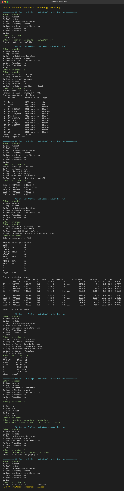

# Air Quality Analysis 

## Subtitle of the Project

A simple Python project that loads, explores, cleans, analyzes, and visualizes air quality data using Pandas, Matplotlib, and Seaborn.

## About the Project

This project is a beginner-friendly Python program that provides an interactive, menu-driven interface for analyzing air quality data. The dataset contains hourly readings of gases such as CO, NO2, and benzene, along with temperature and humidity, collected by a sensor device from March 2004 to April 2005.

The program allows the user to select from the following options:

* Load air quality data from a CSV file.
* Explore the dataset using `head()`, `tail()`, `columns`, `dtypes`, and `info()`.
* Convert the `Date` column from text to date format.
* Perform DataFrame operations such as finding the average temperature, the hottest and coldest readings, and the dates with the highest pollution levels.
* Display, fill, drop, or replace missing values.
* Generate descriptive statistics such as mean, median, minimum, maximum, standard deviation, and variance.
* Generate bar charts, line charts, scatter plots, pie charts, and histograms.
* Customize plots with titles, labels, and legends.
* Save visualizations as image files.
* Exit the program.

The program is organized using an `AirQualityAnalyzer` class. The class encapsulates the data analysis and visualization functionalities.

The project uses Pandas to load, explore, clean, and analyze the air quality data. Matplotlib is used to create the visualizations, and Seaborn and NumPy are imported for further analysis and extension.

The program handles exceptions during file loading and data processing to manage invalid input and operation errors.

The program follows a structured workflow from initialization to data exploration, cleaning, analysis, visualization, and conclusion.

## Output



## Features

* Displays a menu-driven interface for air quality analysis.
* Loads air quality data from a CSV file.
* Explores datasets using Pandas functions.
* Displays dataset information and column data types.
* Converts the `Date` column from text to date format.
* Finds the average temperature of the dataset.
* Finds the top 5 hottest and top 5 coldest readings.
* Finds the date with the highest average CO and the top 5 dates with the highest average NO2.
* Displays rows and columns with missing values.
* Fills missing values with zero using `fillna()`.
* Drops rows with missing values using `dropna()`.
* Replaces missing values with a value entered by the user.
* Calculates statistical measures such as mean, median, minimum, maximum, standard deviation, and variance.
* Generates bar charts to compare pollution levels by date.
* Generates line charts to visualize trends over time.
* Generates scatter plots to analyze relationships between variables such as temperature and humidity.
* Generates pie charts to display proportions.
* Generates histograms to visualize data distributions.
* Customizes charts using titles, labels, and legends.
* Saves visualizations as image files in PNG format.
* Uses exception handling to manage invalid input and file-related errors.
* Uses class methods to organize different operations.
* Uses loops and conditional statements to manage menu selections.
* Allows the user to return to the main menu or exit the program.

## Concepts Used

* Variables and data types.
* User input and output.
* Type conversion.
* Functions and method calls.
* Classes and objects.
* Object-oriented programming.
* Pandas library.
* Matplotlib library.
* DataFrames and Series.
* Reading CSV files using `pd.read_csv()`.
* Exploring datasets using `head()`, `tail()`, and `info()`.
* Date conversion using `pd.to_datetime()`.
* Handling missing values using `isnull()`, `fillna()`, and `dropna()`.
* Grouping data using `groupby()`.
* Finding the largest and smallest values using `nlargest()` and `nsmallest()`.
* Aggregation using `sum()` and `mean()`.
* Statistical calculations using `median()`, `min()`, `max()`, `std()`, and `var()`.
* Statistical summaries using `describe()`.
* Data visualization using Matplotlib.
* Creating bar, line, scatter, pie, and histogram plots.
* Plot customization using titles, labels, and legends.
* Saving plots using `savefig()`.
* Exception handling using `try` and `except`.
* Conditional statements using `if`, `elif`, and `else`.
* `while` loops.
* Menu-driven programming.
* Data analysis and visualization workflow.

## Built-in Functions and Methods Used

* `print()`
* `input()`
* `int()`
* `float()`
* `len()`
* `head()`
* `tail()`
* `info()`
* `describe()`
* `read_csv()`
* `to_datetime()`
* `isnull()`
* `fillna()`
* `dropna()`
* `sum()`
* `mean()`
* `median()`
* `min()`
* `max()`
* `std()`
* `var()`
* `groupby()`
* `nlargest()`
* `nsmallest()`
* `plot()`
* `title()`
* `xlabel()`
* `ylabel()`
* `xticks()`
* `legend()`
* `show()`
* `savefig()`
* `break`

## Technology Used

* Python
* Pandas
* NumPy
* Matplotlib
* Seaborn
* CSV
* Visual Studio Code (VS Code)
* Git
* GitHub

## About the Dataset

The dataset `AirQuality.csv` contains hourly air quality readings from a sensor device in an Italian city (March 2004 to April 2005).

| Column | Meaning |
|---|---|
| Date, Time | When the reading was taken |
| CO(GT) | Carbon monoxide measured by a reference instrument |
| C6H6(GT) | Benzene |
| NOx(GT) | Nitrogen oxides |
| NO2(GT) | Nitrogen dioxide |
| PT08.S1(CO), PT08.S2(NMHC), PT08.S3(NOx), PT08.S4(NO2), PT08.S5(O3) | Readings from five sensors for the same gases |
| T | Temperature in °C |
| RH | Relative humidity in % |
| AH | Absolute humidity |

Readings that were not available in the original file are stored as empty cells (missing values).

## How to Run

### Step 1: Install Python

Download and install Python from the official website:

```bash
https://www.python.org/downloads/
```

### Step 2: Install Required Libraries

Open the terminal and run:

```bash
python -m pip install pandas numpy matplotlib seaborn
```

### Step 3: Open the Project

Open the project folder `air_quality` in Visual Studio Code.

### Step 4: Check the Dataset

Make sure the `AirQuality.csv` file is available in the project directory or at the file path specified in the program.

### Step 5: Run the Program

Open the terminal in the project directory and execute:

```bash
python main.py
```

### Step 6: Analyze Air Quality Data

* Select the desired operation from the main menu.
* Explore and clean the air quality dataset.
* Perform data analysis and statistical calculations.
* Generate visualizations to understand pollution levels, temperature trends, and patterns.
* Save the generated charts as image files.
* Return to the main menu or exit the program.

## Project Structure

```text
│
├── main.py
├── AirQuality.csv
├── output.png
└── README.md
```

## Learning Objectives

By completing this project, you can learn:

* How to load and analyze CSV datasets using Pandas.
* How to explore datasets using `head()`, `tail()`, and `info()`.
* How to identify and handle missing values.
* How to convert text columns into dates.
* How to group data and find the largest and smallest values.
* How to apply aggregation functions to summarize data.
* How to calculate statistical measures such as standard deviation and variance.
* How to analyze air pollution levels and temperature trends.
* How to create different types of charts using Matplotlib.
* How to customize and save visualizations.
* How to use classes and methods to organize a Python program.
* How to handle invalid input using exception handling.
* How to use loops and conditional statements.
* How to create a menu-driven application.
* How to manage a Python project using VS Code, Git, and GitHub.

## Author

Anjali Mehta